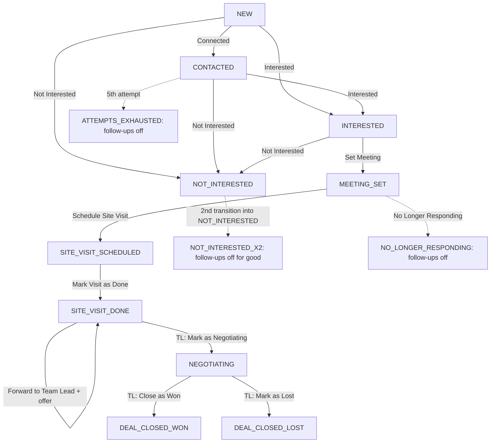

# Lead Lifecycle Audit — Migration 0049 Follow-up Rules (revision 3)

Date: 2026-10-29
Branch: `asad-dev`
HEAD: `be1bab0` `feat(followup): migration 0049 follow-up rules — 5-attempt cap, suppression, customer-requested times`
Scope: corrective reconciliation of the lead-panel Actions order, the forward options, the Set Follow-up modal, and the follow-up scheduling rules, checked against source and isolated tests. No production writes, no migrations, no Auth/RLS, no commit/push/deploy.
Constraint: local and production share one Supabase project. Tests run isolated (stubbed `fetch`, happy-dom, PGlite). Visual verification in a real browser was not performed (no safe environment: the app reads a production-bound anon key and is login-gated); both modals were rendered and exercised in the happy-dom harness instead.

Revisions: revision 2 (2026-10-28) reported 89/89 tests after an implementation that flattened every action into an always-visible disabled list and introduced a default cadence. The corrective directive reverses those two decisions (below). Revision 3 reflects the reconciled code.

---

## 1. Summary

- **86/86 isolated tests pass** at HEAD `be1bab0` after the reconciliation (see §2).
- **Reversed from revision 2:** the always-visible-disabled Actions flattening, and the default-cadence auto-scheduling (`defaultFollowupIso`-driven) in `clearFollowup` / `checkFollowUpReminders`. Both were reverted to the stage-gated / no-auto-reschedule baseline.
- **Corrections applied:** the 9 primary actions render in the required order; non-primary meeting/visit actions stay stage-gated (hidden when not applicable); Not Interested is available through SITE_VISIT_DONE; forwarding is one top-level action whose modal offers the three destinations (agent/team member, Team Lead with offer, myself); the Set Follow-up modal is date + time + note + shared notes with "View all notes" and a quick-add; a customer request recorded only as a note does not change the schedule; no global cadence is introduced.
- **Still open risks:** who may stop/resume follow-ups is a browser rule only (§3, F7); the Migration 0049 file header says "NOT APPLIED" while the live schema has the columns (§3, F8); test-lead cleanup remains UNKNOWN (§6, R10).

---

## 2. Test Results (verified)

Run on 2026-10-29 at HEAD `be1bab0`. Commands and observed totals:

| Suite | Command | Result |
|---|---|---|
| `scripts/leadpanel-interested.test.mjs` | `npx vite-node --config .gate-harness/vite.config.mjs scripts/leadpanel-interested.test.mjs` | `tests 17`, `pass 17`, `fail 0` |
| `scripts/followup-rules.test.mjs` | same runner | `tests 20`, `pass 20`, `fail 0` |
| `scripts/followup-reminders.test.mjs` | same runner | `tests 10`, `pass 10`, `fail 0` |
| `scripts/company-time.test.mjs` | same runner | `tests 6`, `pass 6`, `fail 0` |
| `scripts/forward.test.mjs` | same runner | `tests 6`, `pass 6`, `fail 0` |
| `scripts/test-0049.mjs` | `node scripts/test-0049.mjs` (PGlite) | `27 passed` |
| **Total** | | **86/86 pass** |

None of these suites reaches a real database. `npm run build` (local) succeeds; `eslint` reports no errors on the changed source files.

---

## 3. Findings

Verdicts: **VERIFIED (source/tests)**, **GAP** (works as written, does not meet a stated requirement), **RISK** (unverified or by-design exposure), **UNKNOWN**.

### F1 — Forward

| Claim | Verdict | Evidence |
|---|---|---|
| Forward updates the same lead id; it never creates a lead | VERIFIED (source) | `fwdLead` calls `updLead(leadId, …)` (`src/lib/db.js:1812-1836`) |
| Forward changes only `assignedTo`, `assignedToName`, `assignedRole`, `previousAssignees` (+ `offerSentAt`/`offerValue` on a Team Lead hand-off) and logs one `FORWARDED` row | VERIFIED (source) | same span |
| Status, follow-up, attempts and suppression survive a forward | VERIFIED (tests) | `scripts/forward.test.mjs` (6/6) |
| Self-forward privileges `FORWARDED` (not `NOTE`) and keeps `previousAssignees` | VERIFIED (tests) | `claimLeadForSelf` (`db.js:1691-1711`); asserted |
| `canSelfForward` admits MA, `self_forward`, and Add-Customer holders only | VERIFIED (tests) | `src/lib/constants.js:112-117`; asserted |
| Forward is one top-level action; the modal offers agent/team-member, Team Lead (offer), and Self Forward destinations (the user's own account) | VERIFIED (tests) | `LeadPanel.jsx` + `ForwardModal.jsx`; asserted by `leadpanel-interested.test.mjs` |

### F2 — Not Interested

| Claim | Verdict | Evidence |
|---|---|---|
| The button calls `changeStatus(id, 'NOT_INTERESTED')` | VERIFIED (source) | `LeadPanel.jsx` |
| Offered at NEW, CONTACTED, INTERESTED and through MEETING_SET / SITE_VISIT_SCHEDULED / SITE_VISIT_DONE | VERIFIED (tests) | asserted by `leadpanel-interested.test.mjs` |
| The lead is auto-transferred to the company's Not Interested handler | VERIFIED (source) | `autoTransferNotInterested`, `db.js:1749-1771` |
| `ni_count` is kept by the database trigger; the client never sends it | VERIFIED (source/tests) | `0049_followup_rules.sql:118-122`; `test-0049.mjs` |

### F3 — No Longer Responding

| Claim | Verdict | Evidence |
|---|---|---|
| Sets suppression, clears `nextFollowup`, keeps status, logs a `FOLLOW_UP` row | VERIFIED (source/tests) | `db.js:1956-1959`; `followup-rules.test.mjs` |
| The trigger adds one system audit row on stop and one on resume | VERIFIED (tests) | `test-0049.mjs` |
| Resume is shown only to TL/MGMT and never for `NOT_INTERESTED_X2` | VERIFIED (source) | `LeadPanel.jsx` |

### F4 — Attempt / Log Call

| Claim | Verdict | Evidence |
|---|---|---|
| `MAX_ATTEMPTS = 5`; the 5th attempt suppresses (`ATTEMPTS_EXHAUSTED`) | VERIFIED (source/tests) | `db.js:1912`; `test-0049.mjs`; `followup-rules.test.mjs` |
| Server-side atomic count with a per-click request id; retries do not double-count | VERIFIED (tests) | `lead_log_no_answer`; `followup-rules.test.mjs` |
| A connected call (Log Call) is not an attempt | VERIFIED (source) | `LogCall.jsx` touches only `callCount` |
| Attempt shows the current count (`1/5`) | VERIFIED (source) | `LeadPanel.jsx` renders `(n/5)` |
| Attempt controls: early (NEW/CONTACTED/INTERESTED) and late (MEETING_SET/SITE_VISIT_SCHEDULED), hidden when follow-ups are off | VERIFIED (source) | `LeadPanel.jsx` |

### F5 — Custom follow-up and reminders

| Claim | Verdict | Evidence |
|---|---|---|
| A custom schedule applies only to the lead it was saved on | VERIFIED (tests) | `setFollowUpAt` per-lead; asserted |
| A customer request recorded only as a note does not change the schedule | VERIFIED (tests) | `addNote` writes only a NOTE; asserted by `followup-rules.test.mjs` |
| Surv without a saved custom schedule keep the existing automatic behavior | VERIFIED (source) | `clearFollowup` clears; `checkFollowUpReminders` notifies but never auto-reschedules (no global cadence); asserted |
| Customer-requested timing floor is honoured | VERIFIED (tests) | `nextFollowupFor` / `setFollowUpAt`; asserted |
| Suppressed/closed leads get no follow-up and no reminder | VERIFIED (source/tests) | `followUpBlock`; trigger; asserted |

### F6 — Activity Timeline

| Claim | Verdict | Evidence |
|---|---|---|
| Every writer appends to the same lead's activity list | VERIFIED (source) | `addAct`, `db.js:1603-1613` |
| Server-written rows (RPC, trigger) use fixed ids, so replays do not duplicate | VERIFIED (source/tests) | `0049_followup_rules.sql` |
| Self Forward records `FORWARDED` | VERIFIED (tests) | `claimLeadForSelf` |

### F7 — Authorization

| Claim | Verdict | Evidence |
|---|---|---|
| Stop/resume permission is a browser rule; the database cannot tell a manager from an agent | RISK (by design) | `LeadPanel.jsx`; `0049_followup_rules.sql:44-53` |
| `lead_log_no_answer` is executable by `anon` | RISK (by design) | `0049_followup_rules.sql` |
| Only `postgres`/`service_role` can lift `NOT_INTERESTED_X2` or lower `ni_count` | VERIFIED (tests) | `test-0049.mjs` |

Out of scope: Supabase Auth / RLS (decision D1).

### F8 — Migration 0049 status

| Claim | Verdict | Evidence |
|---|---|---|
| File header says "NOT APPLIED" | VERIFIED (source) | `0049_followup_rules.sql:5-6` |
| The columns exist in production | VERIFIED (indirect) | the No Longer Responding button renders only when `hasColumn('leads','followup_suppressed_at')` succeeds; it rendered in the harness |
| The header is stale | RISK (documentation) | the two rows above disagree |

---

## 4. Lifecycle Flow (unchanged from `be1bab0`)

Forward to Team Lead keeps the status at SITE_VISIT_DONE; the Team Lead moves it on.

---

## 5. Action Table (as reconciled)

Primary order (agent): Connected, Interested, Set Meeting, Not Interested, Attempt (with count), Forward to Agent, No Longer Responding, Log Call, Add Note. Non-primary actions (Attend Meeting, Reschedule Meeting, Schedule Site Visit, Mark Visit as Done, Forward to Team Lead) remain stage-gated — hidden when not applicable — preserving their original rules and sequence.

| Action | Code | Shown when | Gap |
|---|---|---|---|
| Connected | `LeadPanel.jsx` | NEW | — |
| Interested | `LeadPanel.jsx` | always; disabled from INTERESTED on | — |
| Set Meeting | `LeadPanel.jsx` | INTERESTED and `canSee(user,'meeting')` | — |
| Not Interested | `LeadPanel.jsx` | NEW, CONTACTED, INTERESTED, MEETING_SET, SITE_VISIT_SCHEDULED, SITE_VISIT_DONE | — |
| Attempt | `LeadPanel.jsx` | early stages and meeting/visit stages, follow-ups on | hidden when off |
| Follow-up | `LeadPanel.jsx` | CONTACTED, follow-ups on | hidden at other stages |
| Attend / Reschedule / Site Visit / Visit Done | `LeadPanel.jsx` | one stage each | hidden at other stages |
| Forward to Agent (single) | `LeadPanel.jsx` / `ForwardModal.jsx` | when any route applies: team member (owner, open stage), Team Lead (SITE_VISIT_DONE), myself (`canSelfForward` and not owner) | — |
| Forward to Team Lead (`separate button) | — | removed; folded into the Forward modal | — |
| Forward to Myself (separate button) | — | removed; folded into the Forward modal | — |
| No Longer Responding / Resume | `LeadPanel.jsx` | `mayStop` / `mayResume` | — |
| Log Call, Add Note | `LeadPanel.jsx` | always | — |

---

## 6. E2E note

No E2E run was performed in this revision (the 2026-10-28 §6 run in revision 2 predates the reconciliation and used the then-current code). The corrective changes are covered by the isolated suites in §2. Test-lead cleanup from the earlier run remains UNKNOWN (R10).

---

## 7. Risks and Missing Evidence

| ID | Item | Status |
|---|---|---|
| R1 | Forward has unit tests | CLOSED — `scripts/forward.test.mjs` (6/6) |
| R2 | Forward to Agent is a plain hand-off preserving the lead | CLOSED — asserted |
| R3 | No default cadence after a completed or overdue follow-up (reverted by directive) | CLOSED — reverted to baseline; no global auto-reschedule; asserted |
| R4 | Stop/resume permission and `lead_log_no_answer` are open to `anon` | RISK, by design until Supabase Auth (D1); out of scope |
| R5 | `logNoAnswerLocal` (pre-0049 fallback) can lose a count across two devices | RISK, low; the server path is the default |
| R6 | Migration 0049 header "NOT APPLIED" contradicts the live schema | RISK, documentation |
| R7 | Follow-up dialog not seen on screen in a real browser | UNKNOWN visually; exercised in the happy-dom harness |
| R8 | Pre-0049 24h lock card not seen on screen | UNKNOWN visually; covered by unit tests |
| R9 | Customer-requested time not exercised E2E | UNKNOWN E2E; covered by unit tests |
| R10 | Production test lead cleanup (revision 2 run) | UNKNOWN |

---

## 8. Proposed Changes (reconciled)

Implemented and verified (see §9):

1. Agent actions render in the required primary order: Connected, Interested, Set Meeting, Not Interested, Attempt (count), Forward to Agent, No Longer Responding, Log Call, Add Note. Non-primary actions (Attend Meeting, Reschedule Meeting, Schedule Site Visit, Mark Visit as Done, Forward to Team Lead) keep their stage-gated behavior. ✔
2. Forward is one top-level action. Its modal offers: an agent/team member (plain hand-off), a Team Lead (closing hand-off, offer required and unchanged), and myself (`canSelfForward`, recorded as FORWARDED). No separate top-level Forward to Team Lead or Forward to Myself buttons. Every path preserves the same lead id, status, type, notes, history, meeting/visit data, attempt count, schedule and suppression; only ownership and the forwarding event change. ✔
3. Not Interested is available through SITE_VISIT_DONE. ✔
4. The Set Follow-up modal contains Date, Time, Note, Shared Lead Notes with "View all notes", the customer-requested timing constraint, and a "Add a new shared note…" quick-add; all notes go through `addNote`. No meeting-specific fields. ✔
5. A custom schedule applies per-lead; a customer request recorded only as a note does not change the schedule; leads without a saved schedule keep existing automatic behavior; no global cadence is introduced. Customer-requested timing, the 5-attempt cap, and suppression/closed rules are preserved. ✔
6. Regression tests added (ordering/eligibility, forwarding preservation and options, shared notes, per-lead custom scheduling). ✔

Not proposed: Supabase Auth/RLS, a 0049 backfill, editing the 0049 migration file, or committing/pushing.

---

## 9. Implementation Evidence

Work done 2026-10-29 on branch `asad-dev` at HEAD `be1bab0` (preserved, uncommitted; stash `stash@{0}` untouched). No production writes, no SQL, no migrations, no commit/push/deploy.

**Changed files**
- `src/lib/constants.js` — `canSelfForward` now also admits Add-Customer holders (explicit `add_customer` grant, or role default when no custom grant list).
- `src/lib/db.js` — `claimLeadForSelf` logs `FORWARDED` (was `NOTE`) and appends the previous owner to `previousAssignees`. `clearFollowup` / `checkFollowUpReminders` / `setFollowUpAt` are unchanged from baseline (no default cadence; notifications only).
- `src/components/LeadPanel.jsx` — actions reordered to the required primary order; Not Interested widened through SITE_VISIT_DONE; separate top-level Forward to Team Lead and Forward to Myself buttons removed; one Forward to Agent button whose eligibility is the union of the team-member, Team Lead, and self routes.
- `src/components/modals/ForwardModal.jsx` — the `forward-agent` flow now chooses a destination (agent/team member, Team Lead with the offer step, or Self Forward via `claimLeadForSelf`, shown as the user's own account). Set Meeting flow unchanged.
- `src/components/modals/FollowUpModal.jsx` — separate Date and Time inputs replace the datetime-local; presets removed; shared-notes section with "View all notes" and "Add a new shared note…" (all via `addNote`); customer-requested timing checkbox retained.

**Tests added**
| Suite | Result |
|---|---|
| `scripts/leadpanel-interested.test.mjs` (+9) | 17/17 |
| `scripts/followup-rules.test.mjs` (+3) | 20/20 |
| `scripts/forward.test.mjs` (new) | 6/6 |
| `scripts/followup-reminders.test.mjs` | 10/10 |
| `scripts/company-time.test.mjs` | 6/6 |
| `scripts/test-0049.mjs` | 27/27 |
| **Total** | **86/86 pass** |

**Verification notes.** `npm run build` succeeds locally; `eslint` reports no errors on the changed source files. The post-write fast gates flag only pre-existing em-dash / hardcoded tokens in these files (e.g. the `'—'` sentinel comparison `l.company !== '—'`, inline status colors, the native `<select>` in the offer form) — none introduced by this reconciliation. Visual verification in a real browser was not performed: no safe environment exists without a production-bound anon key and a login session. Both modals were rendered and driven in the happy-dom harness (assertions above).

---

## 10. Environment and Safety

- Branch `asad-dev`, HEAD `be1bab0`, `stash@{0}` preserved. Working tree contains this session's uncommitted edits.
- Shared production database: no production writes occurred in this revision.
