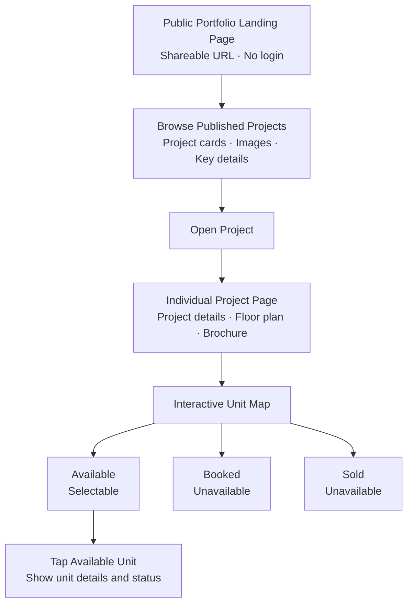

# WECON Public Property Portfolio — Build Plan

## Objective

Add a public, portfolio-style landing page listing WECON projects. Visitors can browse published projects, open a project detail page, inspect its floor plan and brochure, and view unit availability.

The existing individual project route is reported as:

`#/p/<propertyId>`

The current implementation reportedly includes a `Public Project` admin page and a `public_published` field. Inspect the repository to verify the actual implementation before making changes.

## Customer Journey



## Scope

### 1. Portfolio landing page
- Add a public landing page that lists only published projects.
- No login required for public visitors.
- Use responsive project cards.
- Each card should display available source data only:
  - Project cover image, if available.
  - Project name.
  - Location, if available.
  - Project type/category, if available.
  - Short description, if available.
  - A clear “View Project” link/button.
- Clicking a card opens that project's existing public detail route.
- Provide a useful empty state when no projects are published.
- Do not fabricate project content or use unrelated placeholder property facts.
- Do not show unpublished projects publicly.

### 2. Individual project page
Retain and verify the existing route pattern:

`#/p/<propertyId>`

Display available project information, floor plan, brochure, and the interactive unit map.

### 3. Interactive unit map
Normalize unit statuses internally to:
- `available`
- `booked`
- `sold`

Behavior:
- Available: selectable; show unit identifier, status, and details present in source data.
- Booked: visibly unavailable and not selectable.
- Sold: visibly unavailable and not selectable.
- Show status text/labels, not color alone.
- Support desktop pointer and mobile touch interactions.

### 4. Admin publishing
Reuse the existing Public Project admin page and `public_published` field if verified.
- Admin can publish/unpublish a project using existing role and permission conventions.
- Public portfolio displays published projects only.
- Do not claim a toggle persists to Supabase until the migration has been applied and persistence is verified.
- Avoid introducing a second publishing mechanism.

## Data and Integration

- Intended source: existing Weppro/Supabase property data as implemented in the repository.
- Inspect actual code, schema, migrations, RLS policies, and existing adapter before changing anything.
- Do not assume CRM APIs or invent fields/endpoints.
- Reuse the current `publicProjects.js` adapter and existing public project detail page if appropriate.
- Check whether anonymous/public read access returns only published projects and only fields intended for public display.
- Never expose internal notes, customer information, credentials, or unpublished project data.
- If data or images are missing, show a deliberate empty/fallback state. Clearly distinguish missing data from live availability.

## Suggested Layout

1. Header with WECON branding and concise heading.
2. Intro section: “Explore WECON Properties” or existing approved brand copy.
3. Optional category filters only if reliable category data already exists.
4. Responsive grid of published project cards.
5. Each card has “View Project”.
6. Empty/error/loading states.
7. Each project links to its individual detail page.

Do not add unrelated marketing sections, booking forms, lead capture, agent assignment, WhatsApp integration, analytics, or payment workflows.

## Implementation Sequence

1. Inspect the repository, routing, existing public project components, data adapter, and Supabase migrations.
2. Verify the current `Public Project` admin page and publishing field.
3. Verify the public query filters to published projects and exposes only safe fields.
4. Add a portfolio landing route using existing routing conventions. Do not assume a route name; choose one that fits the application and document it.
5. Build responsive project cards using existing design tokens/components.
6. Link cards to the existing `#/p/<propertyId>` detail route.
7. Reuse the current project detail page and unit map; avoid duplicating logic.
8. Add loading, empty, and error states.
9. Test published/unpublished filtering, card navigation, mobile layout, and unit status behavior.
10. Run lint, build, relevant tests, and available security/access gates. Report browser tests separately if no browser is available.

## Acceptance Criteria

- [ ] Public portfolio landing page opens without login.
- [ ] Only published projects appear.
- [ ] Each card uses real project data available in the source.
- [ ] Missing images/details do not break the layout.
- [ ] Selecting a card opens the correct individual project URL.
- [ ] Individual project page displays project details, floor plan, and brochure when available.
- [ ] Available units can be selected to show their details.
- [ ] Booked and Sold units are visibly unavailable and not selectable.
- [ ] Public access does not reveal unpublished projects or private fields.
- [ ] Admin publishing behavior is verified against the applied migration and actual database.
- [ ] Layout works on mobile and desktop.
- [ ] No out-of-scope booking/lead/WhatsApp/analytics features are added.
- [ ] Tests and build results are reported accurately.

---

# Claude Code Implementation Prompt

Paste this prompt into Claude Code from the WECON repository root.

```text
Implement a public portfolio-style landing page for WECON Properties in this
existing repository.

CONTEXT FROM THE PREVIOUS IMPLEMENTATION REPORT
The project reportedly has:
- A public project detail route: #/p/<propertyId>
- A Public Project admin page under Admin
- A Supabase migration adding public_published
- A src/lib/publicProjects.js adapter
- Existing project data and some floor-plan assets

These details came from a prior implementation report. VERIFY them in the actual
repository before relying on them. Do not assume they are all present or deployed.

GOAL
Create a public portfolio landing page where visitors can browse published WECON
projects and open each project's existing public detail page.

CUSTOMER JOURNEY
Public Portfolio Landing Page
  -> Published Project Cards
  -> Select "View Project"
  -> Individual Project Page (#/p/<propertyId>)
  -> Project details, floor plan, brochure
  -> Interactive unit map
       Available: selectable; show unit details/status
       Booked: unavailable; not selectable
       Sold: unavailable; not selectable

PORTFOLIO CARD DATA
Use only real fields available in the repository/data source:
- Project cover image, if present
- Project name
- Location, if present
- Project category/type, if present
- Description, if present
- View Project action

Do not invent property facts. Handle missing images and fields gracefully.
Show only projects that are actually published. If no projects are published,
show a useful empty state.

ADMIN PUBLISHING
Inspect the existing Public Project admin UI, public_published column/migration,
Supabase query, and RLS policies. Reuse the current implementation if possible.
Do not create a second publishing mechanism. Do not claim publishing persistence
works until the migration is applied and the behavior is verified.

SECURITY AND DATA RULES
- Public visitors need no login for intended published project information.
- Never expose unpublished projects, internal notes, customer data, or secrets.
- Verify anonymous read access and the fields returned by public queries.
- Do not invent CRM API endpoints or schema.
- Use existing project conventions and design tokens.
- Do not replace the current stack or rewrite unrelated files.

SCOPE EXCLUSIONS
Do not add booking forms, lead capture, agent assignment, staff dashboards,
WhatsApp integration, analytics, payment, or approval workflows.
Do not expand scope without asking.

WORK PROCESS
1. Inspect routing, current public project components, adapter, Supabase schema,
   migrations, RLS policies, styles, and available tests.
2. Report a short plan and any blocking issue.
3. Implement the portfolio landing route following existing routing conventions.
   Choose and document the route rather than assuming one.
4. Reuse the existing publicProjects adapter and project detail page where possible.
5. Build responsive project cards with correct links to #/p/<propertyId>.
6. Verify publication filtering and public-field safety.
7. Add loading, empty, and error states.
8. Test published/unpublished filtering, card navigation, unit status behavior,
   and responsive layout.
9. Run lint, build, and relevant tests. Report actual command results.
10. If browser tests cannot run, explicitly state that limitation.

ACCEPTANCE CRITERIA
- Portfolio page is public and requires no login.
- Only published projects are listed.
- Project cards use actual available data.
- Every card opens the correct individual project page.
- Existing detail page still works.
- Available units are selectable; Booked and Sold units are not.
- Missing data is handled gracefully.
- Private/unpublished data is not exposed.
- No excluded features are added.
- Verification results are accurate.

Start by inspecting the repository. Do not begin by blindly creating components.
```
